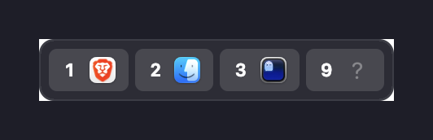

# ctrlgrp


**Control groups for macOS.** Bind apps to number keys, switch with one
keystroke, like in an RTS.

* **Instant.** Event-driven, zero polling, a few megabytes resident.
* **Zero permissions.** No Accessibility, no Input Monitoring, no prompts.
* **Dynamic.** Rebind live with a hotkey, not a config file.
* **Layout-proof.** Physical keys, identical on any layout.
* **Tiny.** One universal binary, zero dependencies, MIT.

## Hotkeys

```
⌥1 … ⌥0     switch to slot; launches if dead, jumps back if already frontmost
⌥⇧1 … ⌥⇧0   bind the frontmost app to that slot
⌥`          HUD
```

While ctrlgrp runs, these combos stop typing their special characters. The
rest of your keyboard is untouched. Going back never resurrects an app you
quit; calling its slot directly does.

## HUD

What's bound where. Pops up when you bind, gone in two seconds, never takes
focus.



## Install

Download the [latest release][releases], drag to Applications, launch. Done.
macOS 14+, Apple silicon and Intel.

Or build it yourself:

```bash
git clone https://github.com/pgrekovich/ctrlgrp.git && cd ctrlgrp && make install
```

First launch from `/Applications` registers a login item. To get rid of
ctrlgrp: quit it from the menu bar item, `make uninstall`, and drop it from
System Settings > General > Login Items.

[releases]: ../../releases/latest

## Config

`~/.config/ctrlgrp/config.json`, hot-reloaded on save:

```json
{
  "defaults": {
    "1": "com.brave.Browser",
    "3": "com.mitchellh.ghostty"
  },
  "hud": { "enabled": true },
  "menubar": { "enabled": true }
}
```

`⌥⇧N` bindings are session-only: restart and the defaults are back. ctrlgrp
never writes this file (one exception: Create Config in the menu when you have
none). The two `enabled` switches are read at launch, everything else applies
on save. Bundle ids:

```bash
osascript -e 'id of app "Google Chrome"'
```

## Menu bar

Reload, edit, reveal the config, quit. Bartender hides new items by default,
so look in its overflow first. Kill the item entirely with
`"menubar": { "enabled": false }`.

## Hacking

```bash
make test   # unit tests for the pure logic
make run    # build the bundle, run in the foreground
log stream --predicate 'subsystem == "com.pgrekovich.ctrlgrp"' --level info
```

Releases: push a tag, CI does the rest (universal build, sign, notarize,
release notes from commit subjects).

```bash
git tag v0.3.0 && git push origin v0.3.0
```
